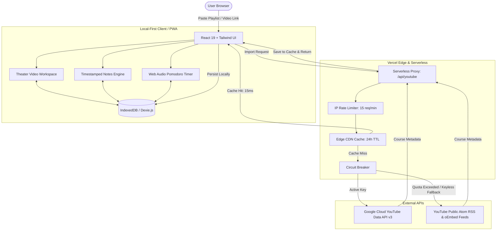

# FocusFlow

> A distraction-free, local-first learning workspace for YouTube developer courses, playlists, and tutorials.

**Live Demo**: [https://focus-flow-puce.vercel.app/](https://focus-flow-puce.vercel.app/)  
**Source Code**: [https://github.com/ssiddiquiii/FocusFlow](https://github.com/ssiddiquiii/FocusFlow)

---

## Overview

YouTube is one of the richest free resources for software engineering tutorials, but it is built for engagement and algorithmic consumption. Autoplay feeds, recommendation rabbit holes, clickbait thumbnails, and distracting comment sections disrupt focused study.

FocusFlow bridges this gap by transforming public YouTube playlists and single-video crash courses into a focused learning environment with zero ads, timestamped markdown notes, and local progress tracking.

---

## System Architecture

FocusFlow combines a **Local-First client storage model** with a **protected edge serverless proxy** to ensure speed, privacy, and zero server infrastructure costs.

### Architecture Diagram



---

## Architectural Principles

### 1. Local-First Client Architecture
- **Complete Data Ownership**: All notes, course catalogs, timestamps, and activity streaks are stored directly on the user's device using browser IndexedDB (Dexie.js).
- **Zero Server Database Costs**: No remote PostgreSQL/MongoDB servers required. The application scales to tens of thousands of users at zero database hosting cost.
- **Privacy by Default**: User study habits, notes, and progress are never tracked or transmitted to external servers.
- **Data Portability**: Full JSON backup export/import and Markdown note exports are built directly into the client.

### 2. Edge API Proxy and Defense
- **API Key Isolation**: The Google Cloud YouTube API key is stored strictly within serverless environment variables and is never exposed in client bundles.
- **Edge CDN & Memory Caching**: Popular courses are cached at the edge for 24 hours (s-maxage=86400, stale-while-revalidate=604800). Subsequent imports for the same course resolve in ~15ms without consuming YouTube API quotas.
- **IP Rate Limiting**: An in-memory sliding window rate limiter restricts each IP address to 15 requests per minute, preventing Denial of Service (DoS) attacks and scraper abuse.
- **Circuit Breaker & Zero-Key Fallback**: If upstream Google API quotas are exceeded, the system automatically trips a circuit breaker and routes requests to YouTube's public Atom/RSS and oEmbed feeds, allowing course imports to continue with zero API key dependency.

---

## Core Features

- **Direct Course Importer**: Import any YouTube playlist or single-video crash course with automated metadata extraction.
- **Clean Slate Onboarding**: New users start with a clean workspace and clear guidance to import their own learning materials.
- **Distraction-Free Video Workspace**: Theater-style player with keyboard shortcuts, auto-fading controls, and playback memory.
- **Timestamped Note Taking**: Take markdown notes while watching; click timestamps to seek the video to specific concepts.
- **Pomodoro Timer**: Synchronized study timer with rest intervals, browser tab countdown sync, and Web Audio alerts.
- **Activity Streak Heatmap**: 30-day activity heatmap tracking daily learning consistency.
- **Command Palette (Ctrl + K)**: Keyboard-driven navigation across courses, settings, and search.
- **Installable PWA**: Offline-capable Progressive Web Application across mobile, tablet, and desktop.

---

## Tech Stack

| Layer | Technology | Purpose |
|---|---|---|
| **Frontend Framework** | React 19, React Router v7 | UI rendering and routing |
| **Build Tool** | Vite 8 | Development server and production bundling |
| **Styling** | Tailwind CSS v4, Lucide Icons | Responsive modern design system |
| **Local Database** | Dexie.js (IndexedDB wrapper) | Client-side persistent storage |
| **Data Validation** | Zod | Runtime schema validation for courses and backups |
| **State Management** | Zustand | Global UI and player state |
| **PWA** | Vite PWA / Workbox | Service worker caching and installability |
| **Edge Proxy** | Vercel Serverless Functions | Secure API gateway, rate limiting, and caching |

---

## Quick Start

### Prerequisites
- Node.js (v18 or higher recommended)
- npm or pnpm

### Setup

```bash
# 1. Clone the repository
git clone https://github.com/ssiddiquiii/FocusFlow.git
cd focus-flow

# 2. Install dependencies
npm install

# 3. Start local development server
npm run dev
```

Open [http://localhost:5173](http://localhost:5173) in your browser.

---
